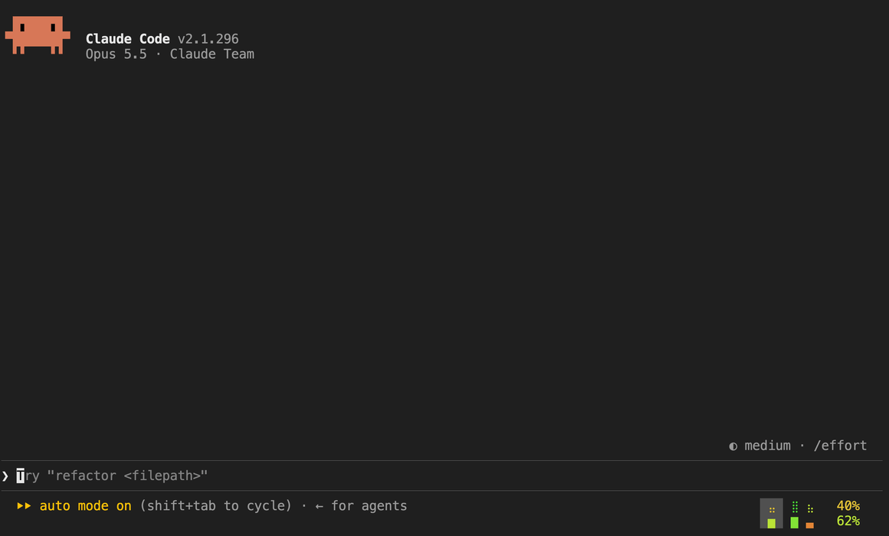

# Claude account rotator

A [Claude Code](https://code.claude.com) mod for people with more than one Claude account. It shows each account's usage under the prompt, and moves your session to another account before the one in use runs out.



<sub>A real session fed imitated accounts (`demo/harness`), so no real account appears.</sub>

## Install

```
/plugin install account-rotator --marketplace ivokund/claude-account-rotator
```

Then click the usage in the footer, press **+ Add an account** and approve the sign-in in your browser. The account you are signed in with now is account 1.

To update, pull the marketplace, then the mod, and start a new session:

```
claude plugin marketplace update claude-account-rotator
claude plugin update account-rotator@claude-account-rotator
```

Or turn on auto-update for the marketplace in `/plugin`. The [changelog](CHANGELOG.md) says what each version changed.

## The footer

A column per account. The top row is the room it has right now (its 5-hour window, or none once its week is spent), the bottom row its week: green with plenty left, red with little. The percents are the account in use's.

Click it for the panel: each account's usage and reset times, **Sign in**, **Use now** and **Remove**, **+ Add an account**, **Rotate now**, **Chrome**, which picks the account Claude in Chrome uses, **Usage based rotation**, which picks the account the rotation moves to, and **Display**, which picks the footer's look:


## What it does

- **Rotates.** Once the account in use is down to 10% of its 5-hour window or 5% of its week, the session moves to another account, and a notice says which and why. **Usage based rotation** in the panel picks which: by default the one whose 5-hour window resets soonest, so room about to refill is used before it does; else the one with the most room, or the next in the list; or **disabled**, which leaves switching to you.
- **Recovers.** A turn that still hits a usage limit or a rejected sign-in switches accounts and asks Claude to carry on.
- **Shows what is really in use.** If a switch doesn't take, the footer and panel go back to the old account, and the rotation stops trying the other one for that session.
- **Follows `/login`.** `/login` signs in the account the session is on, which after a switch isn't Claude Code's login. The mod checks who each account's sign-in belongs to: one that now holds another account's asks for its own again, and the session moves off it; one signed in as an account not on the list becomes that account.
- **Names Claude Code's login.** The panel's second line says which account new sessions start on, and whether it is personal or a Team or Enterprise seat, whose sessions can't switch.
- **Keeps Claude in Chrome working.** Your Chrome extension answers only the account it is signed in to: press **Use this account** next to it in the panel's **Chrome** box. Each window connects Claude in Chrome as that account when it opens, and the connection stays as the rotation moves the window. When a browser call still finds no browser, the mod reconnects it and tells Claude to carry on. See [Claude in Chrome](#claude-in-chrome).
- **Warns.** When every account is near its limit, a line above the prompt says when the next one frees up. When an account needs signing in again, the same line says so and signs it in with one click.

## Requirements

- macOS, where Claude Code keeps sign-ins in the keychain, or Linux, where it keeps them in files.
- Claude Code 2.1.299 or later, in its fullscreen renderer (`/tui fullscreen`), the only one that passes clicks on: the panel opens with a click.
- Any Mac terminal: Terminal.app, iTerm2, Ghostty, Warp, VS Code; on Linux, one with mouse reporting. In iTerm2 the profile's *Enable mouse reporting* must be on, in tmux `set -g mouse on`, and iTerm2's `tmux -CC` mode can't run fullscreen.
- Claude subscription accounts (tested with Max and Team seats). For sessions that switch, keep your `/login` a personal account, Pro or Max: see [Team and Enterprise accounts](#team-and-enterprise-accounts).

Claude Code's own "You've used N% of your session limit" warning can still show for a minute after a switch: the switch lands within about 35 seconds, and warnings Claude Code queued before it still play. No mod can hide it.

Mods are early access in Claude Code, and this one relies on internals a release can change: where sign-ins are stored, and the usage endpoint behind `/usage`.

## Team and Enterprise accounts

The mod moves between personal accounts and Team or Enterprise seats. But Claude Code stops plugins from switching accounts, for the rest of a session, when:

- **the session started on a Team or Enterprise account**, or
- **plugins reloaded while one was in use**: `/reload-plugins`, or installing, enabling or disabling a plugin (since 2.1.299).

The block comes from a built-in security default that stops plugins you install from changing where Claude Code reads its sign-in. It also runs on any machine with managed settings. The mod tells you when a session is blocked, and marks it in the footer.

Ways around it, best first:

| Way | Rotates | For |
| --- | --- | --- |
| 1. [Start on a personal account](#1-start-on-a-personal-account) | Yes | Anyone with a personal account, Pro or Max |
| 2. [Start on a chosen account](#2-start-on-a-chosen-account) | No: restart Claude to change accounts | When all your accounts are seats |
| 3. [Turn the security default off](#3-turn-the-security-default-off) | Yes, untested | A machine you alone control: read its warning first |

### 1. Start on a personal account

The fix. A session that starts on a personal account can switch, to seats as well. New sessions start on Claude Code's login, which the panel's second line names:

- **`/login` with your personal account (Pro or Max)** in a new session. `/login` changes Claude Code's login only in a session on it; in a session the mod moved, it signs in that account instead. It doesn't unblock the session it runs in: restart Claude after.
- **Add Team seats from the panel**, not `/login`: **+ Add an account**, and **Sign in** to renew.
- **Restart Claude when blocked anyway**, as after a plugin reload on a seat: quit, and run `claude --continue` or `claude --resume` to keep your conversation (or plain `claude`). Each starts on your `/login`. Not `/restart`: it stays on the account in use.

### 2. Start on a chosen account

Not a fix: a session started on a seat this way still can't switch. It only picks the account: with only seats, start on the one the footer shows with room, and restart Claude on another when it runs low.

```sh
CLAUDE_SECURESTORAGE_CONFIG_DIR="$HOME/.claude/accounts/2" claude --continue
```

`2` is the account's number in the footer and the panel; plain `claude` starts on account 1, Claude Code's login. Type the path as here, with no `/` at the end and no `~` in quotes: Claude Code and the mod know the account by its exact text, so any other spelling can start signed out, and shows in the panel as a new account. Set it on the command, not with `export`, or every later `claude` in that shell starts there too. Numbers are reused after **Remove**: check the panel before putting one in an alias.

Started this way on a personal account, a session rotates as in 1, with your `/login` left a seat.

### 3. Turn the security default off

> [!WARNING]
> This removes a security protection for every plugin and every session on the machine. With it off, a plugin you install can override what an organization's policy sets for Claude Code (its hooks, prompt content, settings, tool and MCP server rules) and change where Claude Code reads sign-ins and settings from. Anthropic's [Usage Policy](https://www.anthropic.com/legal/aup) forbids intentionally bypassing restrictions or guardrails built into its products. This is a setting Claude Code offers administrators, but using it so a Team session can switch accounts may count as bypassing. Do it only on a machine you alone control, with plugins you trust. Never do it where an organization manages Claude Code, or where your Team or Enterprise organization's rules forbid it.

Managed settings decide whether the default runs: once they set `prependPlugins`, it runs only if listed there. The file must be owned by an administrator, since Claude Code ignores this key in a file your account can write. If the file below already exists, it holds your organization's policy: leave it alone. Otherwise:

```sh
# macOS
sudo mkdir -p "/Library/Application Support/ClaudeCode"
echo '{ "prependPlugins": [] }' | sudo tee "/Library/Application Support/ClaudeCode/managed-settings.json"

# Linux
sudo mkdir -p /etc/claude-code
echo '{ "prependPlugins": [] }' | sudo tee /etc/claude-code/managed-settings.json
```

It applies to sessions started after. Delete the file to turn the default back on. Managed settings an organization sends from Anthropic's servers can override it.

Untested: this follows how Claude Code 2.1.301 describes and reads the setting, but it has not been tried end to end, and a release can change it. You use it at your own risk.

## Claude in Chrome

The Claude extension in Chrome is signed in to one claude.ai account and answers only Claude Code connections made as that account. Claude Code connects Claude in Chrome at a session's first browser call, as the account the session is on then, and keeps that connection until it drops. With the rotation moving sessions between accounts, that is often not the extension's: Claude Code then says the extension is signed in to a different account and suggests `/login`, which doesn't fix it, and in a session the mod moved signs in the wrong account.

- **Pick the extension's account** in the panel's **Chrome** box. It lists the accounts a Chrome extension has answered as, the one this window's Chrome is connected as marked **in use**; **Use this account** connects it as another, in this window now and in new windows from then on. An account joins the list the first time a browser answers as it; until one has, the box lists every account, to pick the extension's. With the extension in several Chrome profiles, each signed in to another account, this picks the profile Claude uses.
- **Connected as a window opens.** Claude Code connects Claude in Chrome with the sign-in the window uses, so the mod visits that account: it moves the window there, waits about 35 seconds for Claude Code to read its sign-in, connects by asking Claude in Chrome which browsers answer, and moves the window back. That uses the account's sign-in, not its usage, so it works with none left. Browser calls wait meanwhile, and a prompt that hits that account's usage limit carries on once the window is back. The connection stays as the rotation moves the window.
- **Reconnects by itself.** After sleep or a network change, the connection comes back as the account in use, and the next browser call finds no browser. The mod visits the extension's account again, runs `/mcp reconnect claude-in-chrome`, and once a browser answers tells Claude to carry on. **Connect** above the prompt does the same by hand. While the window visits the extension's account, its line in the panel says **Connecting Chrome…**, not **in use**.
- **Says what's wrong.** When no Chrome extension answers, the panel and the line above the prompt say so: open Chrome and check its Claude extension is signed in with that account's email; if it is, restart Chrome, which reconnects a stuck extension.

A window Claude Code stops from switching can connect only as the account it is on. Where that isn't the extension's, the line above the prompt gives the command that brings the conversation back in a new session, which starts free to switch: `claude --resume <id>`.

## How it works

- Each account you add gets a folder, `~/.claude/accounts/<n>`, and Claude Code keeps its sign-in in the keychain under that folder's name (on Linux, in that folder's `.credentials.json`), as for any config folder. A switch points the session at another account's sign-in.
- Its only network traffic: each account's usage every 10 minutes, from the endpoint `/usage` reads, and once per sign-in who it belongs to, from the one Claude Code asks at a sign-in, each with that account's own token. In a session with Claude in Chrome it also asks Claude Code's own Claude in Chrome which browsers answer, as the session opens, before moving off the extension's account, and on **Use this account** and **Connect**. Tokens stay where Claude Code keeps them; the mod stores each account's email, organization, plan and last usage, a digest of its token, to tell a new sign-in, and which account your Chrome extension is signed in to.

## Uninstall

Remove each account in the panel, which signs it out. Then run `claude plugin marketplace remove claude-account-rotator`, which uninstalls the mod and deletes what it stored, and delete `~/.claude/accounts`.

## Terms

As of October 2026:

- Neither Anthropic's [Consumer Terms](https://www.anthropic.com/legal/consumer-terms) (October 8, 2025) nor its [Commercial Terms](https://www.anthropic.com/legal/commercial-terms) (June 17, 2025) forbid one person from holding more than one Claude account. The Consumer Terms forbid sharing an account's login details, so add only your own. A Team or Enterprise seat is also under its organization's rules.
- Claude Code's [legal page](https://code.claude.com/docs/en/legal-and-compliance) says the advertised usage limits of Pro and Max assume ordinary, individual usage. It also says Anthropic may enforce its rules on sign-ins and credentials without notice. The mod signs accounts in only through Claude Code's own `claude auth login` and keeps no tokens of its own.
- The Consumer Terms forbid reaching the Services "through automated or non-human means" except with an API key. The mod's usage check every 10 minutes and its "carry on" prompt after a switch run inside Claude Code, as part of your own session, but judge that for yourself.
- The [Usage Policy](https://www.anthropic.com/legal/aup) forbids intentionally bypassing restrictions or guardrails built into Anthropic's products: read the warning in [Turn the security default off](#3-turn-the-security-default-off) first.

Terms change; this is not legal advice. Not affiliated with or endorsed by Anthropic.

## Develop

```
claude --plugin-dir .     # a session with the mod loaded from this folder
claude plugin validate .
claude plugin test .
```

`--plugin-dir` loads this folder over the installed release for that session only, with a list of accounts of its own, so a broken working tree breaks only that window. Keep the marketplace installed from GitHub: added from this folder instead, every window loads the folder as it stands. `/release` publishes a version, by the steps in `.claude/skills/release`.

`demo/record.mjs` records the GIF and `demo/looks.mjs` draws the footer's looks, both from a real session fed imitated accounts; their headers say what they need.

## License

[MIT](LICENSE)
